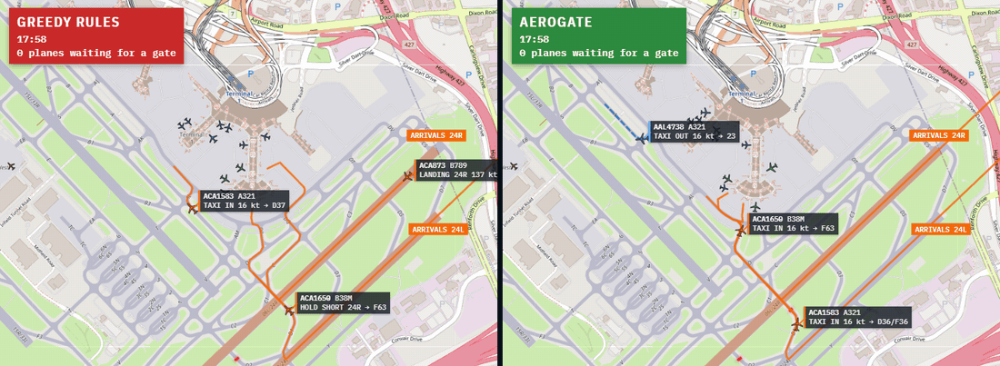
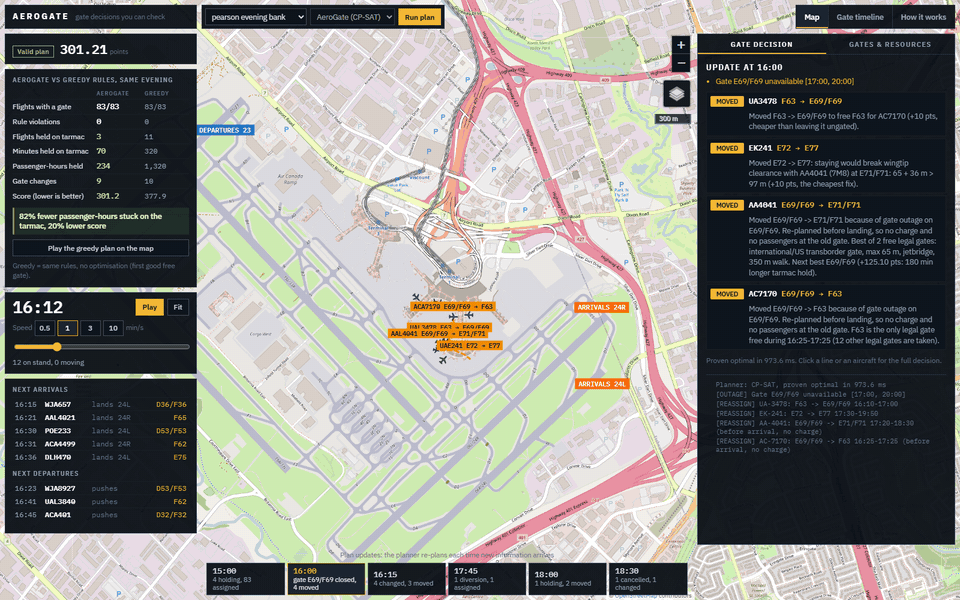
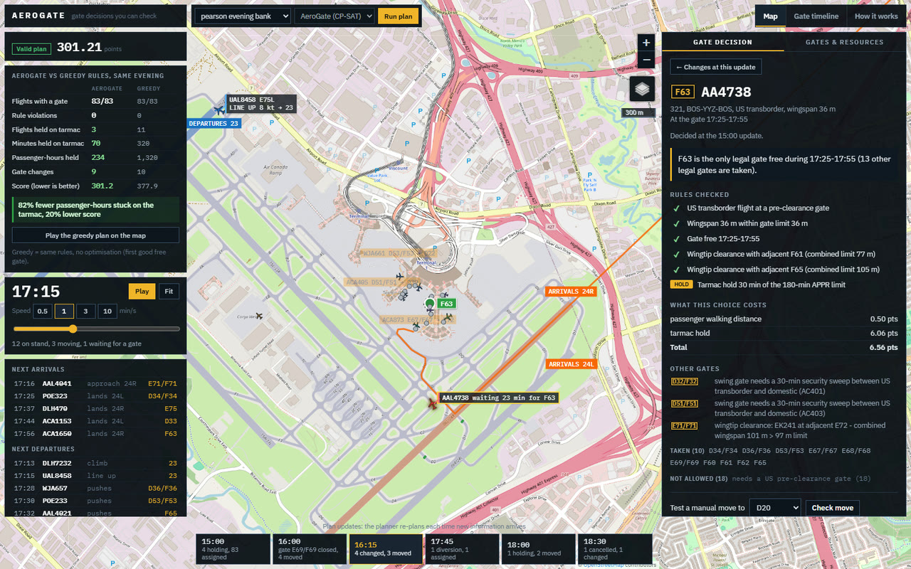

# AeroGate

Gate assignment for Toronto Pearson that keeps the plan valid while the day falls apart: delays,
aircraft swaps, gate outages, diversions. I built it for the Brock Solutions Airport Innovation
Challenge (subproblem 03, gate assignment) at the University of Waterloo.



Left: greedy re-planning (keep each gate, give a waiting flight the first good free gate). Right:
AeroGate. Same evening, same thunderstorm, around 18:12. Under the greedy rules three arrivals sit on
taxiways waiting for a gate. AeroGate re-planned the evening when the storm was announced, so at
this minute nobody is waiting.

## The problem

The challenge provides an evaluator that replays a day at the airport as a series of updates. At
each update my code gets the current state (flights, gates, what changed) and returns new
assignments and moves. The evaluator applies the moves one at a time and ends the run at the first
illegal one. The score charges walking distance (0.01 per metre), moving a flight (10 points, 50 once
the aircraft has arrived) and leaving a flight without a gate (100, or 300 for an emergency).

So the job is to re-plan quickly, never break a rule, and not move published gates unless it pays.

## Approach

At every update I rebuild the rest of the day as a constraint program and solve it with
[OR-Tools CP-SAT](https://developers.google.com/optimization). The choices that mattered:

- **Only legal options go into the model.** Each (flight, gate, tarmac hold) combination that passes
  the hard rules (gate type, wingspan, jetbridge, outages) becomes one yes/no variable. Illegal
  assignments are never created, which keeps the model small and means the solver can't pick one.
- **The objective is the evaluator's score**, read from its config file, so a gate only moves when
  the move saves more than it costs. Moves the airport forced (the old gate became invalid) are free,
  same as in the evaluator.
- **Moves are ordered.** A plan can be optimal and still be rejected: swapping two flights' gates
  works on paper but not when the moves are applied one by one. Integer position variables rule
  that out (below).
- **Everything is re-checked before it's sent.** Each action goes through the evaluator's own
  compatibility code. Anything that would fail is dropped, and if CP-SAT fails, a greedy planner
  (which also warm-starts the solver) takes over, then the challenge's reference planner.
- **Same input, same plan.** One solver thread with a deterministic time budget. Explanations are
  only useful if they don't change between runs.

Each decision is stored with the rules it passed, its cost, and why every other gate lost (which
rule, which flight was in the way, or how many points worse). The dashboard shows these per flight.

### The model

$`x_o \in \{0,1\}`$ selects option $`o=(f,g,h)`$ (flight, gate, tarmac hold); $`u_f`$ leaves flight
$`f`$ without a gate. A flight that already has a gate must end up on one, because the evaluator has
no "unassign" action:

```math
\sum_{o\in\mathcal{O}_f} x_o = 1 \text{ if } f \text{ holds a gate},\qquad
\sum_{o\in\mathcal{O}_f} x_o + u_f = 1 \text{ otherwise}.
```

Each gate gets a no-overlap constraint over optional interval variables $`P_o`$ (present when
$`x_o=1`$). Swing gates need a 30-minute security sweep between flights of different zones, and
neighbouring stands have a combined-wingspan limit; both become pairwise clauses
$`x_a + x_b \le 1`$. The objective, in evaluator points x 100:

```math
\min \sum_o c_o x_o + \sum_f U_f u_f + \sum_{(a,d,n)} \lceil \rho n \rceil \, \lVert \mathbf{p}_a - \mathbf{p}_d \rVert_1
```

where $`c_o`$ adds up walking distance, move costs and a tarmac-hold penalty, and the last term is
connecting passengers walking between gates. The hold penalty is convex so short holds are cheap and
holds near Canada's 3-hour tarmac limit (APPR) are not:

```math
\Phi(t) = 20t + 9000\,(t/180)^4 .
```

Move ordering: give each flight that holds a gate an integer position $`\pi_f`$. If option $`o`$ moves
$`f`$ onto a gate that flight $`b`$ still holds at an overlapping time, then

```math
x_o \Rightarrow \pi_b + 1 \le \pi_f .
```

A swap would need $`\pi_a < \pi_b < \pi_a`$, so any solution can be applied in order of $`\pi`$. When
the evaluator's view differs slightly from the model's and a cycle still shows up, I add a cut that
forbids that combination and re-solve.

The full write-up, including the runway and taxi simulation behind the map, is in
[docs/paper/aerogate_paper.pdf](docs/paper/aerogate_paper.pdf).

## Results

On the challenge's 12 scenarios and on 40 random days from my own generator (random airports of
6 to 40 gates, 12 to 90 flights, delays, swaps, cancellations, outages and diversions announced
30 to 180 minutes ahead):

| | AeroGate | Provided greedy | Provided first-fit |
|---|---:|---:|---:|
| 12 challenge scenarios, total score (lower is better) | 96.2 | 104.3 | 96.8 |
| 40 random days, runs ending in a hard failure | 1 | 3 | 6 |
| 33 days every planner finished, total score | 3,188 | 3,565 | 5,783 |
| Days with the best score (of 33) | 26 | 5 | 0 |

The one failed day can't be saved by any planner: an outage hits a parked widebody while every
compatible gate holds a parked aircraft, and the evaluator can't swap two parked aircraft.

The Pearson evening below (83 flights, a thunderstorm, a jetbridge failure, a medical diversion, a
787 swap and a cancellation), against the same rules re-planned greedily:

| | AeroGate | Greedy rules |
|---|---:|---:|
| Flights with a gate, rule violations | 83/83, 0 | 83/83, 0 |
| Flights held on the tarmac | 3 | 11 |
| Minutes held on the tarmac | 70 | 320 |
| Passenger-hours held (85% load factor) | 234 | 1,320 |
| Score | 301.2 | 377.9 |

AeroGate spends three charged gate moves to avoid most of the tarmac holds. Every re-plan after the
first one is proven optimal in at most 1.5 s.

## The Pearson model and dashboard

The challenge data only knows cargo, domestic and international, so I built a second model of
Terminal 1 from OpenStreetMap: 30 contact gates (including dual-named swing gates such as E67/F67)
and two cargo stands. On top of the challenge rules it has US pre-clearance gates, the swing-gate
security sweep, wingtip limits measured from the real spacing between stands, tarmac holds, and
connecting passengers.



The dashboard plays the plan on the real airfield in Pearson's usual west-flow setup (land on 24R and
24L, take off from 23): 24L arrivals hold short of 24R, aircraft queue for departure, and anything
waiting for a gate holds on an unused taxiway rather than on the apron. Clicking an aircraft shows
the decision behind its gate.



Stand sizes, walking distances, and the crew and baggage numbers on the "Gates & resources" tab are
estimates, not airport data. The ground movement is a rule-based simulation for display; it doesn't
feed back into the plan.

## What didn't work

- A bonus for leaving slack between turnarounds, to absorb future delays, made the total worse on
  the random days (3,582 vs 3,078). Delays are announced before arrival and the evaluator lets you
  move a delayed flight for free, so slack bought in advance was mostly wasted. It's off.
- CP-SAT's interleaved multi-worker search crashed the process on some models, so it runs on one
  worker with a deterministic time limit.
- An early version of the map was an SVG schematic. It looked fake, so the map and every taxi
  route now come from OpenStreetMap.
- Waiting aircraft first parked on pads beside the main taxiway, which put them in the middle of
  the apron. They now taxi to holding spots on taxiways no route uses.

## Running it

```bash
python -m venv .venv                     # Python 3.10+
.venv\Scripts\python -m pip install -r requirements.txt

.venv\Scripts\python dashboard\server.py           # dashboard at http://127.0.0.1:8770
.venv\Scripts\python evaluator.py --scenario flight_data/busy_day.json --solution solution_aerogate
.venv\Scripts\python tools\benchmark.py            # the 12 challenge scenarios
.venv\Scripts\python tools\benchmark.py --dir generated
.venv\Scripts\python -m pytest tests\test_aerogate.py
```

(On macOS or Linux use `.venv/bin/python`.) The first dashboard load plans the evening, which takes
about 20 seconds. `#t=18:12&plan=greedy` opens the greedy version of the storm, and
[docs/TECHNICAL.md](docs/TECHNICAL.md) has the rest of the notes, including a demo script.

## Layout

- `aerogate/`: options, the CP-SAT model, move ordering, greedy fallback, replay, explanations
- `yyz/`: the Pearson layer (OpenStreetMap layout, scenario, simulator)
- `dashboard/`: the server and the map (Leaflet), including the ground-traffic simulation
- `docs/`: the paper, technical notes, README media
- `tests/`, `tools/`: tests, benchmarks, the random-day generator
- `gms/`, `evaluator.py`, `flight_data/` and the other top-level challenge files: from the challenge

## Credits

The evaluator (`gms/`, `evaluator.py`), sample scenarios, reference planners, `visualize.py`,
`flowcharts/`, `CHALLENGE_README.md` and the message specification come from the challenge repo,
[IdeasClinicUWaterloo/F26-Airport-Innovation-Challenge](https://github.com/IdeasClinicUWaterloo/F26-Airport-Innovation-Challenge).
Map data and tiles are (c) [OpenStreetMap](https://www.openstreetmap.org/copyright) contributors
(ODbL). The map uses [Leaflet](https://leafletjs.com/).
