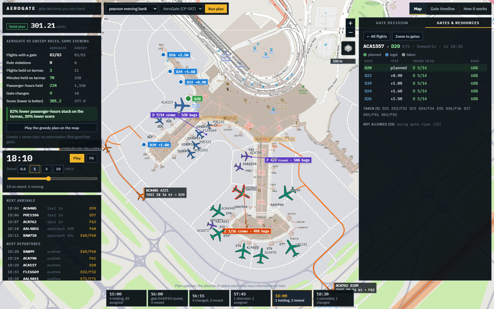
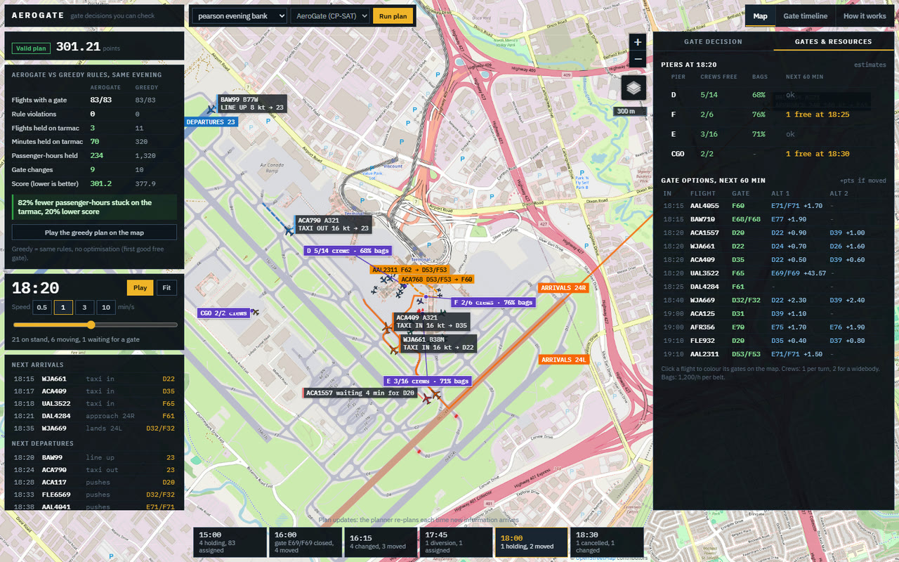
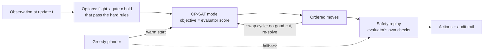

# AeroGate: explainable gate re-planning for Toronto Pearson

**Every gate, re-planned exactly at every disruption, with the reason for every decision.**
Built by Shawn Wei for the Brock Solutions Airport Innovation Challenge (subproblem 03, gate
assignment), University of Waterloo.


*Same evening at Pearson, same thunderstorm, same rules. **Left:** greedy re-planning, the way
rule-based tools work (keep gates, take the first good free gate): arrivals stack up on the taxiways
waiting for a gate. **Right:** AeroGate re-plans the whole evening the moment the storm is announced,
so their gates are ready when they land.*

---

## Results at a glance

**Pearson evening bank**: 83 flights, a thunderstorm bunching seven arrivals, a jetbridge failure on a
swing gate, a 777 medical diversion, a 787 swap on a US flight and a cancellation.

| Same evening, same disruptions | **AeroGate** | Greedy rules |
|---|---:|---:|
| Flights with a gate | **83 / 83** | 83 / 83 |
| Rule violations | **0** | 0 |
| Flights held on the tarmac | **3** | 11 |
| Minutes held on the tarmac | **70** | 320 |
| Passenger-hours stuck on the tarmac | **234** | 1,320 |
| Score (lower is better) | **301.2** | 377.9 |

> **82% fewer passenger-hours on the tarmac and a 20% lower score**, while every re-plan after the
> first is *proven optimal* in at most 1.5 s.

**Challenge benchmarks** (official evaluator, lower score is better; a hard failure ends a run):

| | **AeroGate** | Provided greedy | Provided first-fit |
|---|---:|---:|---:|
| 12 challenge scenarios, total score | **96.2** | 104.3 | 96.8 |
| Hard failures on the challenge scenarios | **0** | 0 | 0 |
| 40 random disrupted days, hard failures | **1** (unavoidable) | 3 | 6 |
| Total score, 33 days every planner finishes | **3,188** | 3,565 | 5,783 |
| Days won outright (of 33) | **26** | 5 | 0 |

---

## What it does

### Re-plans every gate at every update, exactly
At each update (a delay, a swap, a gate outage, a diversion) AeroGate rebuilds the whole remaining day
as a constraint program and solves it with Google OR-Tools CP-SAT. The objective *is* the evaluator's
score, so a published gate only moves when moving it saves more than it costs.


*The 16:15 storm update: three flights moved before they landed (no charge, no passengers at the old
gate), four kept their gates. Arrows show every gate change; the right panel says why.*

### Explains every decision
Every decision records the rules it passed (with the numbers), what it costs in evaluator points, and
why **every other gate** lost: broke a rule, taken by whom, or how much worse.


### Never sends an illegal action
Moves are ordered so they can be applied one at a time, every action is re-checked with the
evaluator's own rules before it is returned, and a chain of fallbacks (greedy plan, then the provided
reference planner) means the decision function never fails.

### Shows the plan on the real airfield
A Pearson model built from OpenStreetMap: 30 Terminal 1 gates (including dual-named swing gates such
as E67/F67), US pre-clearance, security sweeps on swing gates, wingtip clearance from the real stand
spacing, tarmac holds priced against Canada's 3-hour APPR limit, and connecting passengers. The map
animates the plan in Pearson's usual west-flow setup (land 24R/24L, depart 23), with runway crossings,
conflict-free taxiing, and aircraft holding on unused taxiways instead of the apron.

| Gate options for one flight | Ground crew and baggage per pier |
|---|---|
|  |  |
| Green planned, blue legal (+points if moved there), grey taken. | Crews free and bag-belt load per pier (planning estimates), and the best alternatives for each arrival in the next hour. |

---

## How it works



**Options.** Every flight $`f`$, gate $`g`$ and tarmac hold $`h`$ that passes the hard rules (gate
type, wingspan, jetbridge, outages) becomes a yes/no option $`o=(f,g,h)`$. Rule-breaking pairs are
never created, so the solver cannot pick them.

**Variables and constraints.** $`x_o\in\{0,1\}`$ picks an option, $`u_f\in\{0,1\}`$ leaves a flight
ungated:

```math
\sum_{o\in\mathcal{O}_f} x_o = 1 \;\; (f \text{ already holds a gate}),\qquad
\sum_{o\in\mathcal{O}_f} x_o + u_f = 1 \;\; (\text{otherwise})
```

```math
\textsf{NoOverlap}\big(\{\langle P_o, x_o\rangle : o \text{ on gate } g\}\big)\quad \forall g,
\qquad x_a + x_b \le 1 \quad \forall (a,b)\in\mathcal{C}_{\text{sweep}}\cup\mathcal{C}_{\text{wingtip}}
```

where $`P_o`$ is the option's occupancy (optional interval variables), sweep pairs are swing-gate
flights of different zones less than 30 min apart, and wingtip pairs are neighbouring stands whose
combined wingspan exceeds the limit measured from the real stand spacing,
$`L=\max\big(76,\ 2(\delta-7.5)\big)`$.

**Objective = the evaluator's score** (integers, points x 100):

```math
\min \sum_o c_o x_o + \sum_f U_f u_f + \sum_{(a,d,n)} \lceil \rho n\rceil\,\lVert \mathbf{p}_a-\mathbf{p}_d\rVert_1,
\qquad
c_o = d_g + 500\,\mathbb{1}[\text{premium}] + 1000\,\mathbb{1}[\text{move}] + 5000\,\mathbb{1}[\text{move after arrival}] + \Phi(\tau_f+h)
```

with walking distance $`d_g`$, a free move when the airport caused it, connecting passengers
$`(a,d,n)`$, and a convex tarmac-hold penalty that climbs steeply toward the 180-minute APPR limit:

```math
\Phi(t) = 20\,t + 0.9\,U_0\,(t/180)^4,\qquad U_0 = 10\,000 .
```

**Move ordering.** The evaluator applies reassignments one at a time, so a swap (A to B's gate, B to
A's) is optimal on paper but impossible to apply. Integer positions $`\pi_f`$ forbid it:

```math
x_o \;\Rightarrow\; \pi_b + 1 \le \pi_f \qquad \text{if } o \text{ moves } f \text{ onto a gate } b \text{ still holds at an overlapping time.}
```

A cycle would need $`\pi_{f_1}<\pi_{f_2}<\dots<\pi_{f_1}`$, so every solution can be applied in order of
$`\pi`$; any residual cycle gets a no-good cut and a re-solve.

**Solving.** One CP-SAT worker with a fixed seed and a *deterministic* time budget (same input, same
plan), warm-started from the greedy plan, which is also the fallback.

The full write-up (12 pages, with the surface simulation, runway sequencing, holding-spot routing and
overlap-free rendering) is in **[docs/paper/aerogate_paper.pdf](docs/paper/aerogate_paper.pdf)**;
implementation notes are in [docs/TECHNICAL.md](docs/TECHNICAL.md).

---

## Run it

```bash
python -m venv .venv                       # Python 3.10+
.venv\Scripts\python -m pip install -r requirements.txt      # (macOS/Linux: .venv/bin/python)

# operator dashboard -> http://127.0.0.1:8770
.venv\Scripts\python dashboard\server.py

# score a scenario with the official evaluator
.venv\Scripts\python evaluator.py --scenario flight_data/busy_day.json --solution solution_aerogate

# benchmarks and tests
.venv\Scripts\python tools\benchmark.py                   # 12 challenge scenarios
.venv\Scripts\python tools\benchmark.py --dir generated   # 40 random disrupted days
.venv\Scripts\python -m pytest tests\test_aerogate.py
```

Demo links once the dashboard is running (the first load plans the evening, about 20 s):

* `http://127.0.0.1:8770/#t=18:12&plan=greedy`: the storm under greedy rules; press **Back to AeroGate**.
* `http://127.0.0.1:8770/#t=16:15`: the storm update and its explanations.
* `http://127.0.0.1:8770/#t=18:10&rtab=res&sel=ACA1557&zoom=gates`: one flight's gate options.

Without OR-Tools, AeroGate falls back to its greedy planner and keeps working.

## Repository layout

| Path | What |
|---|---|
| `aerogate/` | The optimiser: options, CP-SAT model, move ordering, greedy, safety replay, explanations |
| `yyz/` | Pearson realism layer: layout from OpenStreetMap, scenario, simulator |
| `dashboard/` | Operator dashboard (standard-library server + Leaflet map, ground-traffic simulation) |
| `docs/` | Paper (PDF + LaTeX), technical notes, media |
| `tests/`, `tools/` | Tests, benchmark and scenario generators |
| `gms/`, `evaluator.py`, `flight_data/`, ... | Challenge framework (see Credits) |

## Credits

* Challenge framework, evaluator (`gms/`, `evaluator.py`), sample scenarios (`flight_data/`), reference
  planners (`solution_firstfit.py`, `solution_scored.py`), `visualize.py`, `flowcharts/`,
  `CHALLENGE_README.md` and the message specification: Brock Solutions Airport Innovation Challenge,
  IdeasClinic, University of Waterloo
  ([IdeasClinicUWaterloo/F26-Airport-Innovation-Challenge](https://github.com/IdeasClinicUWaterloo/F26-Airport-Innovation-Challenge)).
* Map data and tiles (c) [OpenStreetMap](https://www.openstreetmap.org/copyright) contributors, ODbL.
  Map library: [Leaflet](https://leafletjs.com/) (BSD-2-Clause).
* Solver: [Google OR-Tools](https://developers.google.com/optimization) CP-SAT.

Stand sizes, walking distances, crew counts and baggage figures in the Pearson layer are estimates.
